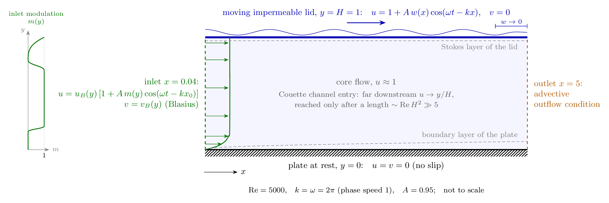

# DSM cover streaklines

Streakline (dye) images of a forced flat-plate boundary layer, white on black, made for a journal-cover / gallery submission, plus green "PIV-style" wallpapers and a phone Live Photo.

Author: Rauan Kelesbekov, University of Alberta.

## What is solved

The flow is a **Couette-type channel**: a flat plate at rest at the bottom and an impermeable lid at the top that moves along the flow with mean speed 1, the speed of the oncoming stream. A travelling wave of the tangential velocity runs along the lid. Far downstream a steady Couette channel would reach the linear profile u = y/H, but viscosity needs a length of order Re·H² ≈ 5000 to spread across the channel. On the computed length 5 the flow is therefore a channel *entry* flow: a boundary layer grows on the plate, a thin Stokes layer forms under the oscillating lid, and the core between them moves with u ≈ 1.

Two-dimensional incompressible Navier–Stokes equations, lengths scaled by the plate length, velocities by the oncoming speed:

$$\frac{\partial \mathbf u}{\partial t}+(\mathbf u\cdot\nabla)\mathbf u=-\nabla p+\frac{1}{\mathrm{Re}}\nabla^2\mathbf u,\qquad \nabla\cdot\mathbf u=0,\qquad \mathrm{Re}=5000,$$

on $0.04\le x\le 5$, $0\le y\le H=1$, with

| Boundary | Condition |
|---|---|
| plate, $y=0$ | $u=v=0$ (no slip) |
| lid, $y=1$ | $u=1+A\,w(x)\cos(\omega t-kx)$, $v=0$ (impermeable, moving) |
| inlet, $x=x_0=0.04$ | $u=u_B(y)\,[1+A\,m(y)\cos(\omega t-kx_0)]$, $v=v_B(y)$ |
| outlet, $x=5$ | advective outflow condition of the solver |

- $u_B, v_B$: the Blasius profile of a plate whose leading edge is at $x=0$, taken at $x=0.04$.
- $k=\omega=2\pi$: wavelength 1, period $T=1$, so the lid wave travels downstream with phase speed 1, the speed of the core flow. $A=0.95$.
- $w(x)$: the lid wave amplitude is tapered smoothly to zero over the last 0.5 before the outlet, $w=\tfrac12[1+\cos(\pi(x-4.5)/0.5)]$ for $x>4.5$ and $w=1$ elsewhere. Without it the wave grew without bound at the outlet column.
- $m(y)$: which part of the inlet oscillates with the lid. It rises smoothly from 0 to 1 on $0.157<y<0.2125$, falls back to 0 on $0.70<y<0.80$, and grows as $((y-0.8)/0.2)^3$ up to the lid, as in the May 2026 MATLAB run. The two bands of shear between oscillating and steady fluid roll up into the large vortices at the plate and under the lid.
- The forcing amplitude is ramped up over the first period; 12 periods are computed.

Solver: Fortran DSM (copy of the campaign source), stream-function formulation, grid 496 × 176 refined at the plate (Δy = 0.0015) and under the lid (Δy = 0.002), Δt = T/4096. Periodicity of the flow at A = 0.95 was not checked; the dye is carried through the saved periods in time order.

**This is not the setup of the DSM article** (Re = 800, open prescribed upper boundary, numerical steady inlet with a region upstream of the plate). The run was made only for the picture, so the image is not a reused article figure.

To rebuild the figure: `cd figures && pdflatex domain.tex && magick -density 250 domain.pdf -background white -alpha remove -alpha off domain.png`.

## Dye and drawing

- Dye released without pause at the inlet along the May rows (34 rows over the height, 12 extra rows in the upper 30 %, none above 0.95 H) and a thin wall sheet.
- RK4 advection through the saved periods in time order (bilinear in space, linear between the 128 saved phases).
- Point insertion: when two neighbouring particles of one streakline separate by more than 0.006, a new particle is inserted at the Catmull–Rom midpoint and advected with the others (stops at 1/256 of the release spacing).
- Lines drawn with Pillow on a 3× raster and reduced with Lanczos. No generative or AI processing.

## Files

- `images/COVER_2550x3300.png`, `images/COVER_5100x6600.png`: the cover, six strips 1/8 period apart.
- `wallpapers/`: green 532 nm colouring, phone 1290 × 2796 and desktop 3840 × 2400.
- `livephoto/`: one forcing period compressed in time to 3.2 s, 2 s and 1.5 s (MP4), and Live Photo packages `.pvt` (2 s, 1.5 s). Double-click a `.pvt` on a Mac to import it into Photos. iOS lists such synthetic Live Photos in the library but, so far, not as live lock-screen wallpapers.
- `scripts/`: `render_cover_seq.py` (sources, field, time-continuous RK4), `live_wallpaper.py` (dye with point insertion and the Live Photo frames), `make_live_wallpaper.swift` (AVFoundation pair with content identifier and still-image-time track), `wallpaper_piv.py` (green colouring). They need the native period files of the run, which are not in this repository.
